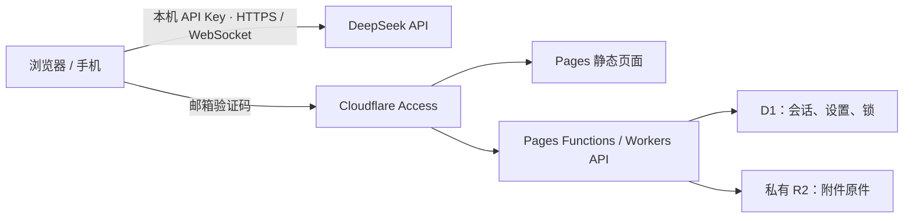

# DSH Chat

基于 [DeepSeek 官方 chat-demo](https://github.com/deepseek-ai/chat-demo) 改造的单用户聊天应用。前端部署到 Cloudflare Pages，Pages Functions 提供 Workers API，D1 保存聊天和设置，私有 R2 保存附件。

DeepSeek 请求由浏览器直接发送，API Key 只保存在当前设备的 localStorage。Cloudflare Access 使用邮箱验证码保护站点；不同设备共享聊天、附件和设置，同一个对话通过租约锁保证只有一端能修改。

本项目保留上游 MIT 许可，并非 DeepSeek 官方产品。

## 相对官方 Demo 的主要变更

| 方面           | 本项目的变化                                                                                                        |
| -------------- | ------------------------------------------------------------------------------------------------------------------- |
| 部署与登录     | 增加 Pages Functions、D1、R2、自定义域名与 Access 邮箱登录；后端验证 JWT，旧地址跳转到正式域名                      |
| 多端同步       | 会话和非秘密设置保存到服务端；同一对话使用单写入者租约，支持只读查看、主动接管和本地恢复副本                        |
| 参数选择       | 暴露模型、思考强度、联网搜索、阅读链接、安全等级、系统提示词、标题生成、历史长度、输出限制、采样和文件解析等参数    |
| 设置持久化     | 全局默认在设备间同步；单个对话可以覆盖默认值，回答保留当时的生成参数                                                |
| 独立工具       | 增加 Search、Fetch、OCR、ASR、TTS、文件管理、余额、JSON 输出、FIM、手动 Function Calling 及三种协议的 JSON 请求入口 |
| 文件与语音     | 原附件另存私有 R2；支持文件有效期、语音输入、音色选择、自动朗读和流式朗读选项                                       |
| 大备份导入     | 保留 DeepSeek / Demo ZIP 导入，增加进度、暂停、刷新续传、去重、压缩上传和有限并发；保留原始聊天时间                 |
| 完整备份与删除 | ZIP 导出包含会话分支、设置及可用原件；批量删除不再逐个下载正文，保留其他端正在操作的对话                            |
| 手机与安装     | 沿用并完善移动布局，增加 PWA、离线页面资源缓存及云端状态显示                                                        |

原 Demo 的流式回答、Markdown、数学公式、Mermaid、搜索引用、图片、消息编辑和分支操作继续保留。接口行为以 [DeepSeek 官方 API 文档](https://api-docs.deepseek.com/zh-cn/guides/build_a_chatbot.md) 为准。

## 架构与数据边界



- **Key 不同步**：不写入 Worker 配置、D1、R2、备份或日志。更换设备或站点域名时，需要重新填写。
- **聊天明文存储**：云端数据由登录保护，不是端到端加密；浏览器中有本地缓存与恢复副本。
- **服务端鉴权**：验证 Access JWT 的签名、issuer、audience、有效期、应用类型、邮箱和正式域名；不信任单独的邮箱请求头。
- **没有复杂同步服务**：不依赖 Durable Objects、KV、队列或 CRDT，不进行逐 Token 广播。生成期间定期保存会话快照。

### 同一对话的操作权

打开对话时申请 60 秒租约，每 20 秒续租，客户端按 55 秒保守判断失效。服务端写入同时检查锁 Token 和版本，防止旧页面覆盖新内容。接管会立即更换锁，旧页面在下一次续租或保存时停止写入，并保留尚未同步的恢复副本。

不同对话可以分别操作。手机锁屏或系统挂起页面可能中断生成；重新打开后获取操作权即可，不能保证后台持续生成。

## 本地运行

需要 Node.js 22.12+ 和 pnpm。依赖版本由 `packageManager` 与锁文件约束。

```sh
pnpm install --frozen-lockfile
cp wrangler.example.jsonc wrangler.jsonc
cp .dev.vars.example .dev.vars
pnpm password
```

把密码生成器输出的整段哈希填写到 `.dev.vars` 的 `ADMIN_PASSWORD_HASH`，保留 `AUTH_MODE="password"`。这是本地开发登录密码，与 DeepSeek Key 无关。

```sh
pnpm db:local
pnpm build
pnpm dev:cloud
```

访问 [localhost:8788](http://localhost:8788)。需要前端热更新时另开终端运行 `pnpm dev`，访问 [localhost:8090](http://localhost:8090)，开发服务器会把 `/api` 转到本地 Worker。

`wrangler.jsonc` 是被 Git 忽略的本地配置，公开模板为 `wrangler.example.jsonc`。已有配置时不要重复复制覆盖。本地模式不会访问远端 D1/R2。

## 部署到 Cloudflare

完整步骤见 [部署指南](docs/DEPLOYMENT.md)。生产使用 Access，密码模式只用于本地开发。

1. 用 Cloudflare CLI 检查或创建 Pages 项目、D1 和私有 R2；已有部署优先复用资源。
2. 复制 `wrangler.example.jsonc` 为 `wrangler.jsonc`，填写实际绑定。
3. 绑定自定义域名和代理 CNAME，等待域名及证书激活；创建仅允许指定邮箱的 Access 自托管应用，启用 One-time PIN。
4. 在本地配置中填写 `APP_ORIGIN`、`ACCESS_TEAM_DOMAIN`、`ACCESS_AUD`、`ACCESS_EMAIL`，保持 `AUTH_MODE=access`。
5. 检查、迁移并部署：

```sh
node scripts/cloud.mjs check
pnpm type
pnpm lint
pnpm test
pnpm db:remote
pnpm deploy
```

`pnpm deploy` 会先校验配置、构建前端，再由 Wrangler 打包上传 Pages Functions。生产分支默认 `main`，可用 `DSH_DEPLOY_BRANCH` 显式指定。公开模板含占位值，远端迁移与部署会拒绝直接使用它。

这里仍是 **Pages + Pages Functions**。`cf deploy dist` 的纯静态部署方式不足以发布本项目的函数和绑定，不应将它当作等价命令。`cf` 负责资源编排，Wrangler 负责本地 Pages 构建与上传。两者的登录状态不一定共享；只能使用各自公开的登录流程或受保护的 API Token 环境变量，不读取 CLI 私有凭据缓存。

### 给 AI 部署代理的执行指引

可以把下面这段作为部署任务的起点；具体命令示例和验收标准见 [AI 部署流程](docs/DEPLOYMENT.md#ai-部署流程)。

> 阅读 README、部署指南和现有配置。先执行 `cf auth whoami` 确认当前账户，使用 `cf cli search` 发现当前 CLI 版本的资源命令，再查看命中命令的 `--help` / `cf schema`。搜索词只描述资源和动作，不放入账号、邮箱、域名或资源 ID。核对 Pages、D1、R2、DNS 和 Access 的现状，复用正确的资源，不覆盖无关 DNS 或扩大共享 Access 策略。仅将真实配置写入被 Git 忽略的本地文件。执行检查、D1 迁移和 Pages 部署，验证匿名访问受阻、邮箱登录可用、旧地址不能绕过鉴权、聊天与附件可读取。沿用用户已有授权；仅在缺少必要信息或遇到新的破坏性操作时询问。不要打印令牌、API Key、Cookie 或完整认证跳转 URL，也不要自动删除用户聊天来做验收。

## 导入、备份和恢复

- 支持 DeepSeek / Demo ZIP、本站完整 ZIP，以及本地恢复 JSON。导入追加到云端，完全相同的已导入对话会跳过，不覆盖已有聊天。
- 先完整校验并暂存备份，再分批上传。每批最多 5 个对话、最多 3 个并发批次，大 JSON 使用 gzip；附件按内容去重。
- 页面显示进度，支持暂停和刷新后继续。暂存和完成进度留在当前设备 IndexedDB；清理浏览器数据后可重新选择原 ZIP，服务端仍会去重。
- 完整 ZIP 导出包含消息分支、生成参数、设置和可取得的附件原件，不包含 API Key、登录凭据或锁 Token。
- 上游备份没有提供的原件无法补回，缺失项会保留引用。不要把“有附件文件名”理解成“备份一定包含该文件”。
- 批量删除按每批 100 个处理，跳过其他端持有有效锁的对话，显示结果后允许重试。删除聊天不自动清理 R2 原件，以免破坏恢复副本；长期使用时可在备份后另行清理未引用对象。

## 使用边界

- 主聊天使用 Messages 协议，Responses / Chat Completions 可在工具箱中调用。工具箱结果不会自动进入聊天上下文。
- Function Calling 目前是手动填写工具结果的工作台，不自动执行代码或外部程序。
- 模型和模式会限制可用参数；不适用的参数会禁用或不发送。扩展工具模式的输出上限不是整轮费用上限。
- 语音需要 HTTPS 和麦克风权限；手机自动播放也可能要求先进行一次手动播放。
- PWA 只缓存页面资源，不缓存云端 API 响应、附件或 DeepSeek 请求。离线仅能查看此前保存的本地内容。
- 本项目没有宣称覆盖 DeepSeek API 的全部组合，也没有在自动测试中调用付费 DeepSeek 接口。

## 检查与仓库结构

```sh
pnpm type
pnpm lint
pnpm test
pnpm build
pnpm smoke:cloud https://chat.example.com https://project.pages.dev
```

`pnpm test` 使用 Miniflare D1/R2 验证 JWT、旧密码失效、锁竞争、接管、过期、版本校验、Unicode 分片、导入去重、压缩和批量删除。线上 smoke 脚本只检查匿名访问和旧域名跳转，不写数据。

GitHub Actions 在推送和 Pull Request 时运行类型检查、lint、测试和构建，使用 `packageManager` 指定的 pnpm 版本。上游的 GitHub Pages 发布流程已替换为检查流程；Cloudflare 发布按部署指南执行。

```text
functions/                 Pages Functions 入口与正式域名跳转
server/                    Access、开发密码、D1/R2 与会话锁 API
shared/preferences.ts      设置类型与可同步字段白名单
migrations/                D1 增量迁移
src/services/cloud/        同步请求、租约与保存队列
src/services/chat/         会话、分支、缓存、导入导出与恢复
src/services/api/          浏览器直连 DeepSeek
scripts/                   本地运行、部署校验、密码生成与线上检查
public/                    PWA、静态资源、响应头与路由
wrangler.example.jsonc      可提交的通用配置模板
wrangler.jsonc              实际部署配置；Git 忽略
```

公开仓库只保留示例域名、邮箱和资源占位值。不要提交 `.dev.vars`、真实部署配置、聊天 ZIP、数据库副本、日志、令牌或个人验收记录。
